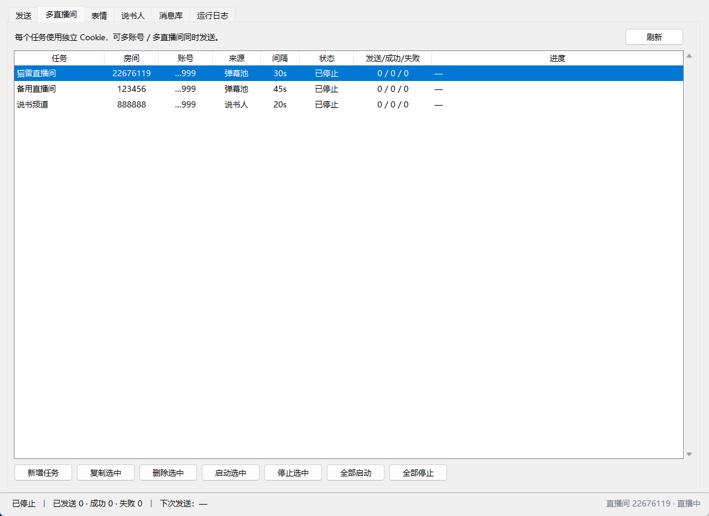
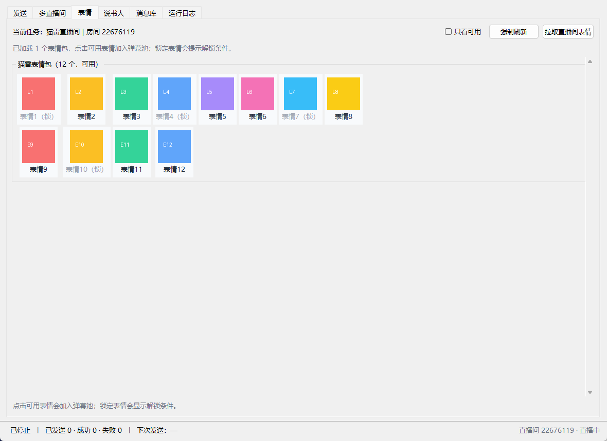
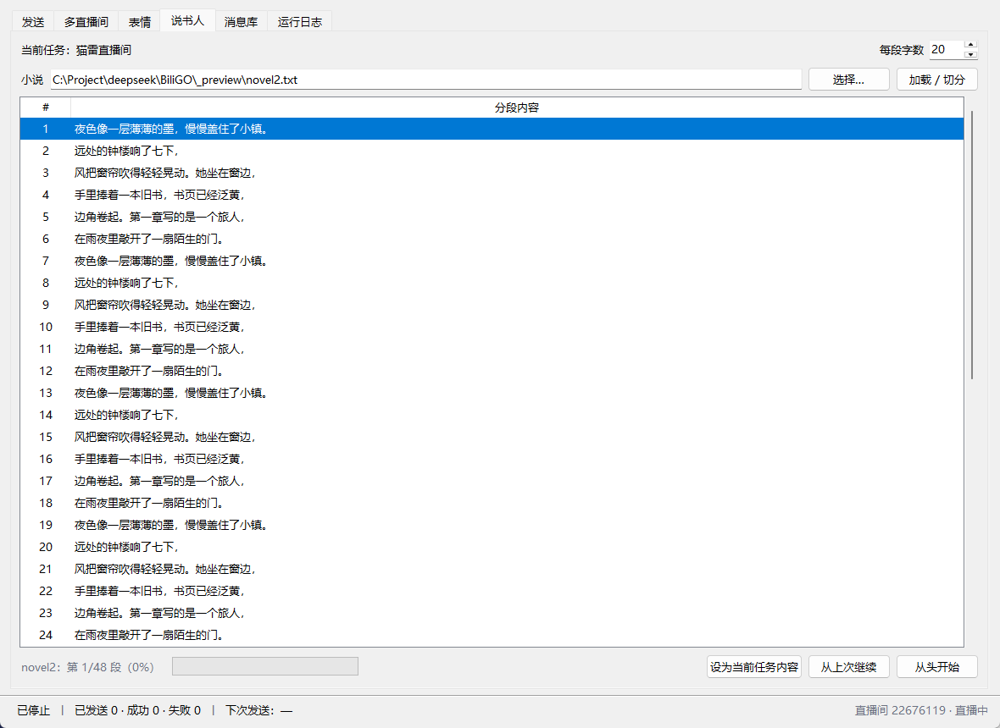

# BILIBILI_SEND · 直播弹幕助手

一个用 **Python + Tkinter** 写的 B 站直播弹幕助手：

- 多直播间 / 多账号同时发送（每个任务独立 Cookie）
- 自动检测账号可用的弹幕颜色与显示模式（顶部 / 底部 / 彩色通常需要舰长或房管）
- 拉取直播间专属表情，标记可用 / 锁定，缓存到本地，一键加入弹幕池
- 说书人模式：读小说、自动分段、按顺序发送并保存进度
- 单条弹幕自定义发送
- 弹幕池支持权重随机 / 完全随机、避免连续重复

不需要数据库、不需要构建工具，也没有任何第三方 Python 依赖。

## 下载免安装版（推荐）

**https://github.com/StayAlivez/BILIBILI_SEND_PY/releases**

- 包名：`BILIBILI_SEND_PY_v2.0.0_portable_win64.zip`
- 内置 Python 3.11.9 运行时（含 tkinter），解压后双击 `run.bat` 即可，**无需安装 Python**
- 仅支持 Windows 10 / 11 64 位
- 如果双击没反应，改双击 `debug.bat`，控制台里会显示具体报错

## 界面预览

发送页：当前任务的房间、Cookie、来源、颜色 / 模式、单条弹幕。


多直播间：每个任务独立 Cookie，可单独或全部启停。



表情：按接口返回的 `perm` 标记可用 / 锁定，图片本地缓存。



说书人：小说自动分段，发送进度随时保存。



消息库与日志：


## 功能说明

### 多直播间 / 多账号

- 每个任务保存自己的房间号、Cookie、间隔、颜色、位置、内容来源、说书进度。
- 「新建」会复制当前任务的配置（包括 Cookie），方便同一账号开多个直播间；不同账号就分别粘贴 Cookie。
- 「多直播间」页可以查看所有任务的状态、发送数、进度，支持逐个或全部启动 / 停止。
- 每个任务一个独立线程，互不阻塞；一个任务登录失效不会影响其他任务。

### 权限检测（颜色 / 顶部 / 底部）

发送前会调用 B 站接口获取**当前账号在该直播间可用的弹幕配置**：

- 未登录或普通用户：通常只有「滚动」和「白色」可用；
- 顶部 / 底部弹幕、彩色弹幕：通常需要舰长、提督、总督或房管身份；
- 检测结果会显示在发送页的「权限：」一行，颜色和位置下拉框只列出可用项；
- 即使手动选了不可用项，发送线程也会自动退回「滚动 + 白色」，并在日志里说明原因。

B 站规则可能调整，以接口返回的 `status` 为准。

### 直播间专属表情

- 在「表情」页点「拉取直播间表情」，会按当前任务的 Cookie 与房间拉取表情包。
- 每个表情按 `perm` 标记：可用 / 锁定；锁定会显示解锁条件（舰长、礼物、等级等）。
- 表情图片缓存到 `cache/emoticons/<房间>_<账号>/`，下次打开可直接使用；「强制刷新」会重新拉取。
- 点击可用表情会追加到当前消息库（弹幕池），权重为 1。
- 发送时使用 B 站播放器的表情弹幕参数（`dm_type=1` + `emoticon_unique`）。
  如果某种表情发送失败，日志里会带上返回码，方便判断是权限还是参数问题。

### 说书人模式

- 在「说书人」页选择 `.txt` 小说，自动按标点和字数切成 ≤20 字的段落。
- 「设为当前任务内容」后，该任务的来源变为说书人；点「开始发送」会按顺序朗读。
- 每成功发送一段就保存 `novel_index`，关闭程序后再启动会从上次的位置继续。
- 「从头开始」会重置进度；小说播完后再启动会询问是否重新开始。
- 支持 UTF-8 / GB18030 编码；每段字数可在 5–20 之间调整（改变字数会重置进度）。

### 单条弹幕

- 发送页底部「单条弹幕」输入框，最多 20 字，点「发送」立即发一条。
- 使用当前任务的 Cookie、房间、颜色和位置，不影响弹幕池和说书进度。

### 弹幕池

- 支持权重随机 / 完全随机；权重 0 表示暂不参与；可避免连续两条相同。
- 支持导入 / 导出 JSON；表情也会以特殊条目存在弹幕池里。

## 运行要求

- Windows 10 / 11
- Python 3.9+（已在 3.11 与 3.14 上实测；建议 python.org 安装包，自带 tkinter）
- 不需要数据库、不需要额外依赖

## 从源码运行

1. 克隆或下载本仓库。
2. 双击 `run.bat`（或执行 `python main.py`）。
3. 在「发送」页填房间号，点「检测直播间 / 权限」确认主播、开播状态和可用颜色 / 模式。
4. 粘贴 Cookie（必须包含 `SESSDATA` 与 `bili_jct`）。
5. 选择内容来源（弹幕池 / 说书人），确认间隔。
6. 点 **▶ 开始发送**；想停就点 **■ 停止**。
7. 需要多个直播间时，在「多直播间」页点「新增任务」，分别填房间和 Cookie，然后全部启动。

### Cookie 怎么拿

1. 浏览器登录 [bilibili.com](https://www.bilibili.com)。
2. 按 `F12` 打开开发者工具 → 「网络 / Network」→ 刷新页面。
3. 随便点一个请求，在「请求头 / Request Headers」里找到 `Cookie:`，把整串值复制出来。
4. 回到程序点「粘贴剪贴板」。

### 录屏 / 演示时的隐私

- Cookie 框默认是密码框，只显示圆点；仍可直接输入或粘贴，**不会把值显示在屏幕上**。
- 只有勾选「显示 Cookie」才会明文显示；录完记得再取消勾选。
- 「保存所有任务 Cookie 到 config.json」默认开启；录屏前取消勾选会立即清除所有任务已保存的 Cookie。
- 打码状态下状态栏只显示「Cookie 可用（已打码）」，不显示 UID。
- 任务表里的账号只显示 UID 后四位（如 `…6390`）。
- 运行日志只记录「已粘贴 N 个键」和账号昵称，不写入 Cookie 内容或完整 UID。
- 免安装包里不包含 `config.json`，解压后是干净的初始状态。

## 消息文件格式

`messages/` 下自带两份示例，支持：

```json
["好听", "666", "可爱"]
```

```json
[
  { "msg": "好听", "weight": 3 },
  { "msg": "666", "weight": 1 }
]
```

表情条目由「表情」页自动写入，形如：

```json
{
  "msg": "",
  "weight": 1,
  "emoticon_unique": "room_22676119_123",
  "emoticon_url": "https://i0.hdslb.com/...",
  "emoticon_name": "妙"
}
```

- `weight` 越大越容易被抽到；`weight` 为 0 表示暂不参与。
- 超过 20 字会在日志里提醒（B 站普通用户上限）。

## 目录结构

```
BILIBILI_SEND_PY/
├── main.py                 # 入口：默认 GUI，--cli 走命令行
├── run.bat                 # Windows 双击启动（免安装版自动用内置 runtime）
├── debug.bat               # 同上，但保留控制台，便于看报错
├── config.json             # 配置（多任务 + 当前任务镜像；含 Cookie，不提交）
├── config.example.json     # 配置样例（无 Cookie）
├── messages/               # 弹幕消息列表
├── bili_send/
│   ├── config.py           # 全局配置 + 任务配置、迁移与校验
│   ├── messages.py         # 消息解析 + 权重/等概率抽取 + 表情条目
│   ├── novel.py            # 小说读取与分段
│   ├── sources.py          # 弹幕池 / 说书人内容来源
│   ├── client.py           # B 站接口：登录、房间、权限、表情、发弹幕
│   ├── emoticons.py        # 表情缓存（JSON + 图片）
│   ├── runner.py           # 每任务一个发送线程
│   ├── gui.py              # Tkinter 界面
│   └── logbus.py           # 日志汇入界面
├── tools/
│   ├── build_portable.py   # 构建内置 Python 的免安装包
│   └── publish_release.py  # 创建 Release 并上传压缩包
├── tests/test_core.py      # 单元测试（不联网）
├── docs/                   # 截图与 Release 说明
└── cache/emoticons/        # 表情缓存（自动生成）
```

## 命令行模式

```bat
python main.py --cli
```

读取 `config.json` 里的**当前任务**，按 Ctrl+C 停止；说书进度会在退出时保存。
适合配合任务计划或开机自启。

## 测试

```bat
py -3 -m unittest discover -s tests -v
```

覆盖消息解析、权重抽取、配置迁移、任务校验、Cookie 打码、权限解析、表情解析、表情发送参数、
小说分段、说书进度、发送线程启停与权限回退，全部使用假网络，不会真的发弹幕。

## 打包免安装版

需要本机有一份**带 tkinter 的 Python 3.11 完整安装**（版本与 embeddable 包一致）：

```bat
py -3 tools/build_portable.py --python-home "C:\...\pythoncore-3.11-64" --proxy http://127.0.0.1:7897
```

脚本会下载官方 embeddable 包（缓存到 `.cache/`）、补入 tkinter / Tcl / Tk，
自检通过后输出 `dist/BILIBILI_SEND_PY_v2.0.0_portable_win64.zip`。

## 注意事项

- **频率**：B 站对弹幕有冷却限制，太快会返回 `10031` / `-509`。建议间隔 ≥ 10 秒。
- **自动停止**：登录态失效（`-101` / `-111`）或连续失败 5 次时，该任务会自动停下并提示。
- **多账号**：每个任务可以填不同账号的 Cookie；同时发多个直播间时请自行控制频率和账号风险。
- **风控**：本工具仅用于个人学习，弹幕内容和账号风险由使用者自负，请遵守 B 站社区规则。
- **表情**：专属表情的可用性由 B 站接口的 `perm` 决定；如果发送时返回权限相关错误，以 B 站返回为准。

## 常见问题

| 现象 | 处理 |
| --- | --- |
| 顶部 / 底部 / 彩色选不了 | 账号没有舰长 / 房管身份，接口只返回可用项；普通用户只能滚动 + 白色 |
| 发送失败 `code=10031` / `-509` | 间隔太短，调大对应任务的「发送间隔」 |
| 发送失败 `code=-101` | Cookie 过期，重新复制该任务的整串 Cookie |
| 发送失败 `code=-111` | Cookie 里缺少 `bili_jct`，或该值与登录态不匹配 |
| 发送失败 `code=-400` | 常见于 Cookie 已失效；检查任务 Cookie |
| 表情页提示「账号未登录」 | 拉取表情需要登录 Cookie |
| 表情显示「（锁）」 | 该表情未解锁，悬停日志/点击会提示所需舰长、礼物或等级 |
| 消息文件不存在 | 启动时会提示并回退到 `messages/weighted.json`，也可在发送页重新选择 |
| 说书进度不对 | 修改每段字数会重置进度；可在「说书人」页点「从头开始」 |
| 双击 `run.bat` 闪退 | 改双击 `debug.bat` 看报错；或重装 python.org 版并勾选 Add to PATH |
| 界面中文乱码 | 用 `run.bat` 启动（内部已 `chcp 65001`） |
