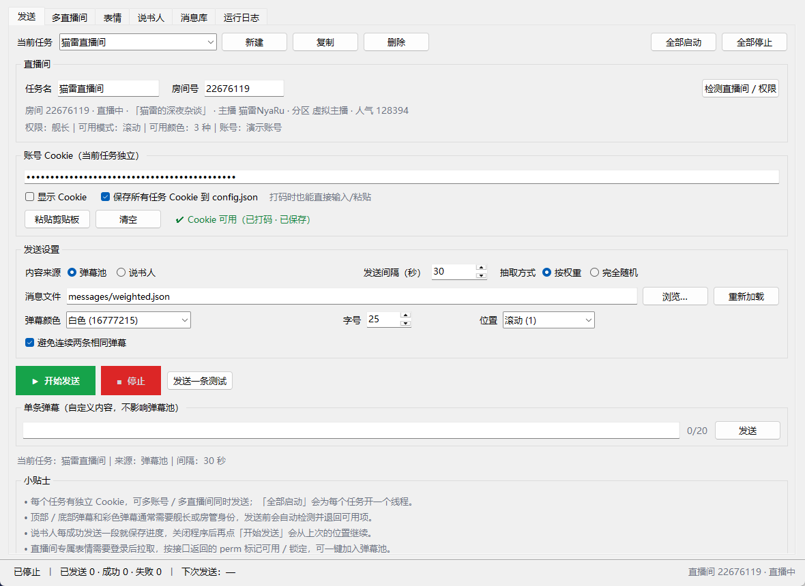
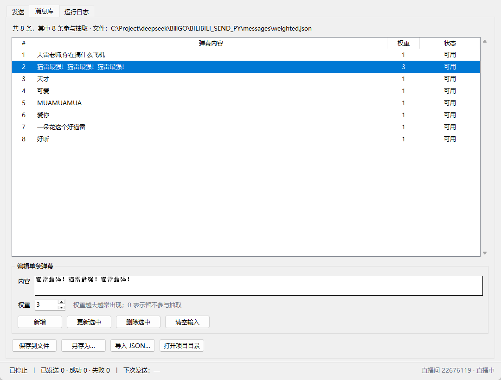
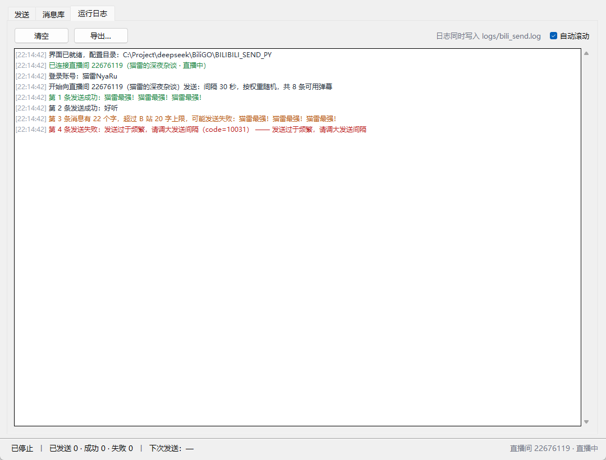

# BILIBILI_SEND · 直播弹幕助手（Python 版）

原 `BILIBILI_SEND` 是一个 Spring Boot 工程：为了定时给 B 站直播间发几条随机弹幕，引入了
Spring Web / WebFlux、MyBatis-Plus、Druid、MySQL 驱动，还要在 IDEA 里跑 `@SpringBootTest`
再 `Thread.sleep(100000000)` 等着。这里把它重写成 **纯 Python + Tkinter**：双击打开一个窗口，
填好 Cookie 点「开始发送」即可，没有任何第三方依赖，也不碰数据库。

> 原 Java 版是另一个 Spring Boot 工程，仍保留在本地工作区，方便对照；本仓库只包含 Python 版。

## 界面预览

发送页：填房间号、Cookie、间隔，点「开始发送」即可（`docs/send.png`）。



消息库：直接在表格里增删改，权重 0 表示暂不参与（`docs/messages.png`）。



运行日志：成功/警告/错误分色显示，同时写入 `logs/bili_send.log`（`docs/log.png`）。



## 对比

| | Java 版 | Python 版 |
| --- | --- | --- |
| 启动方式 | IDEA 里跑测试类 | 双击 `run.bat`（免安装版内置运行时），或 `python main.py` |
| 依赖 | Spring Boot 3.1、WebFlux、MyBatis-Plus、Druid、MySQL、fastjson | 仅标准库（`tkinter` + `urllib`），**无需 pip install** |
| 配置 | `application.yml`（含 MySQL 连接） | `config.json`，界面里直接改，关闭时自动保存 |
| 数据库 | 需要本地 `bigjava` 库，否则启动报错 | 不需要 |
| 消息列表 | 手改 JSON 文件 | 「消息库」页签增删改，也能导入/导出 JSON |
| 日志 | IDEA 控制台 | 「运行日志」页签 + `logs/bili_send.log` |
| 停止 | 只能杀掉测试进程 | 点「停止」，当前请求结束后立即退出 |

## 运行要求

- Windows 10 / 11
- Python 3.9+（已在 3.11 与 3.14 上实测；建议 [python.org](https://www.python.org/downloads/) 安装包，自带 tkinter）
- 不需要数据库、不需要 Maven / JDK

## 下载免安装版（推荐）

不想装 Python 的话，直接下载 Releases 里的压缩包：

**https://github.com/StayAlivez/BILIBILI_SEND_PY/releases**

- 包名：`BILIBILI_SEND_PY_v1.0.0_portable_win64.zip`
- 内置 Python 3.11.9 运行时（含 tkinter），解压后双击 `run.bat` 即可，**无需安装 Python**
- 仅支持 Windows 10 / 11 64 位
- 如果双击没反应，改双击 `debug.bat`，控制台里会显示具体报错

## 从源码运行

需要本机装有 Python 3.9+（python.org 版，自带 tkinter）：

1. 双击 `run.bat`（或执行 `python main.py`）打开界面。
2. 「直播间」填房间号（短号也行），点「检测直播间」确认房间号、标题、开播状态。
3. 粘贴 Cookie（必须包含 `SESSDATA` 与 `bili_jct`），下方会显示「✔ Cookie 可用（UID …）」。
4. 确认消息文件、发送间隔、颜色/位置，点 **▶ 开始发送**。
5. 想停就点 **■ 停止**；状态栏会实时显示已发送 / 成功 / 失败与倒计时。

发送时会自动把短号解析成真实房间号，并按设置随机（或按权重）抽取弹幕。
每次点「开始发送」前，程序还会调用一次 B 站 `nav` 接口确认 Cookie 仍处于登录状态；
如果 Cookie 已过期，会直接提示而不是空发一堆失败请求。

### Cookie 怎么拿

1. 浏览器登录 [bilibili.com](https://www.bilibili.com)。
2. 按 `F12` 打开开发者工具 → 「网络 / Network」→ 刷新页面。
3. 随便点一个请求，在「请求头 / Request Headers」里找到 `Cookie:`，把整串值复制出来。
4. 回到程序点「粘贴剪贴板」。

Cookie 会明文保存在 `config.json` 里，仅本机使用；失效后重新复制即可（B 站 Cookie 通常几个月有效）。

## 消息文件格式

`messages/` 下自带两份示例，两种写法都支持：

```json
["好听", "666", "可爱"]
```

```json
[
  { "msg": "好听", "weight": 3 },
  { "msg": "666", "weight": 1 }
]
```

- `weight` 越大越容易被抽到；`weight` 为 0 表示暂不参与。
- 也接受单个对象 `{"msg": "...", "weight": 1}`（原项目里的 `3.json` 就是这种）。
- 权重是 1:50（1:3）时用「按权重随机」；想完全等概率就选「完全随机」。
- 弹幕内容里的换行会被压成空格；超过 20 字会在日志里提醒（B 站普通用户上限）。

## 与 Java 版配置项的对应关系

| 原 `application.yml` | 现 `config.json` |
| --- | --- |
| `BiLiBiLi.cookie` | `cookie` |
| `BiLiBiLi.live.send.msg.roomid` | `room_id` |
| `BiLiBiLi.live.send.intervalSeconds` | `interval_seconds` |
| `BiLiBiLi.live.send.msgJsonPath` | `messages_file` |
| `BiLiBiLi.live.send.msg.color` | `color` |
| `BiLiBiLi.live.send.msg.fontsize` | `fontsize` |
| `BiLiBiLi.live.send.msg.mode` | `danmaku_mode`（1 滚动 / 5 顶部 / 4 底部） |
| `Demo2.run(1)` / `run(2)` | 抽取方式：完全随机 / 按权重随机 |
| `BiLiBiLi.live.send.msg.csrf` | 自动从 Cookie 的 `bili_jct` 读取 |

## 目录结构

```
BILIBILI_SEND_PY/
├── main.py                 # 入口：默认 GUI，--cli 走命令行
├── run.bat                 # Windows 双击启动（免安装版自动用内置 runtime）
├── debug.bat               # 同上，但保留控制台，便于看报错
├── config.json             # 配置（首次运行/关闭界面时自动生成，含 Cookie，不提交）
├── config.example.json     # 配置样例（无 Cookie）
├── messages/               # 弹幕消息列表
│   ├── weighted.json       # 带权重（默认使用）
│   └── plain.json          # 纯文本
├── bili_send/
│   ├── config.py           # 配置读写与校验
│   ├── messages.py         # 消息解析 + 权重/等概率抽取
│   ├── client.py           # B 站接口：Cookie、CSRF、房间解析、发弹幕
│   ├── runner.py           # 后台发送线程（可随时停止）
│   ├── gui.py              # Tkinter 界面
│   └── logbus.py           # 日志汇入界面
├── tools/
│   └── build_portable.py   # 构建内置 Python 的免安装包
├── tests/test_core.py      # 单元测试（不联网）
└── logs/bili_send.log      # 运行日志（自动生成）
```

## 命令行模式

想挂后台、不需要窗口时：

```bat
python main.py --cli
```

它读取同一个 `config.json`，按 Ctrl+C 停止；适合配合任务计划或开机自启。

## 测试

```bat
py -3 -m unittest discover -s tests -v
```

覆盖消息文件解析、JSON 容错、权重抽取、Cookie 解析、发送表单编码、接口错误码、
配置读写与发送线程启停，全部使用假网络，不会真的发弹幕。

## 打包免安装版

需要本机有一份**带 tkinter 的 Python 3.11 完整安装**（版本与 embeddable 包一致）：

```bat
py -3 tools/build_portable.py --python-home "C:\...\pythoncore-3.11-64" --proxy http://127.0.0.1:7897
```

脚本会下载官方 embeddable 包（缓存到 `.cache/`）、补入 tkinter / Tcl / Tk，
自检通过后输出 `dist/BILIBILI_SEND_PY_v1.0.0_portable_win64.zip`。

## 注意事项

- **频率**：B 站对弹幕有冷却限制，太快会返回 `10031` / `-509`。建议间隔 ≥ 10 秒。
- **自动停止**：登录态失效（`-101` / `-111`）或连续失败 5 次时，发送线程会自动停下并弹窗提示。
- **风控**：本工具仅用于个人学习，弹幕内容和账号风险由使用者自负，请遵守 B 站社区规则。

## 常见问题

| 现象 | 处理 |
| --- | --- |
| 发送失败 `code=10031` / `-509` | 间隔太短，调大「发送间隔」 |
| 发送失败 `code=-101` | Cookie 过期，重新复制 `SESSDATA` 等整串 Cookie |
| 发送失败 `code=-111` | Cookie 里缺少 `bili_jct`，或该值与登录态不匹配 |
| 发送失败 `code=-400` | B 站对未登录请求会返回「请求错误」；检查 Cookie 是否已失效 |
| 启动时提示「Cookie 已失效」 | `nav` 接口判定未登录，重新复制 Cookie（整串） |
| 提示 Cookie 不完整 | 勾选「网络」里 `Cookie` 整串，不要只复制 `SESSDATA` |
| 双击 `run.bat` 闪退 | 命令行运行 `python main.py` 看报错；重装 python.org 版并勾选 Add to PATH |
| 界面中文乱码 | 用 `run.bat` 启动（内部已 `chcp 65001`） |
| 想改默认房间/间隔 | 直接在界面改，关闭时自动写入 `config.json` |
